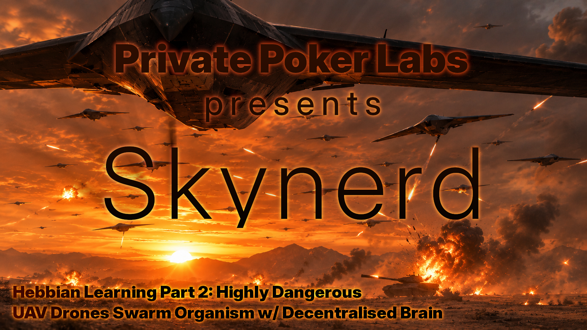

# Skynerd

A fully Hebbian drone-swarm simulator, spun off from `privatepoker-labs/p2p_nerual_spatial/simulator_sp.py`.

<p align="center"></p>

One learning mechanism everywhere — no autopilot, no teacher. The swarm learns
to fly by dying, to fight by watching kills, and to remember through itself:
every living drone is a shard of the brain, death erases a shard, births are
mosaics of the living. Designed by the Sonia Code & Fetch.ai (2026).

This is terminal app only, which runs in-memory simulation.
There is also live simulation with UX and 3D graphics under [SKYNERD - GENESIS](/skynerd_genesis/README.md)


## Seting up

Install dependencies using frozen versions:

```sh
pip install -r requirements.txt
```

Alternatively install SciPy and Torch:

```sh
pip install scipy torch
```

## Running

Simulation can be ran with:

```sh
python ./skynerd/sim_runner.py 
```

Sim has also few options:
```sh
python ./skynerd/sim_runner.py --help
```

The `--seed` option sets RNG seed, giving different simulation results. Runs with same seed are deterministic.

The `--waves` option sets number of drone waves to run. More waves gives longer simulation.

The `--wave-size` options sets number of drones in a single wave. We were interested to see if that affects survival ratio.

Example run with output:
```sh
% python ./skynerd/sim_runner.py 
wave   0: mean 15.46s  best 20.00s  deaths 10/16
wave   1: mean 12.47s  best 20.00s  deaths 15/16
wave   2: mean 13.51s  best 20.00s  deaths 12/16
wave   3: mean 13.67s  best 20.00s  deaths 14/16
wave   4: mean 13.39s  best 20.00s  deaths 15/16
wave   5: mean 13.50s  best 20.00s  deaths 14/16
wave   6: mean 13.73s  best 20.00s  deaths 13/16
wave   7: mean 15.19s  best 20.00s  deaths 12/16
wave   8: mean 12.34s  best 18.82s  deaths 16/16
wave   9: mean 13.77s  best 20.00s  deaths 14/16
==============================================================================
SKYNERD WAVE REPORT
==============================================================================
wave | drones | deaths | median | mean   | best  | full-horizon survivors
-----+--------+--------+--------+--------+-------+-----------------------
   0 |     16 |     10 |  16.15 |  15.46 | 20.00 | 6
   1 |     16 |     15 |  11.77 |  12.47 | 20.00 | 1
   2 |     16 |     12 |  13.84 |  13.51 | 20.00 | 4
   3 |     16 |     14 |  12.48 |  13.67 | 20.00 | 2
   4 |     16 |     15 |  13.00 |  13.39 | 20.00 | 1
   5 |     16 |     14 |  12.11 |  13.50 | 20.00 | 2
   6 |     16 |     13 |  13.13 |  13.73 | 20.00 | 3
   7 |     16 |     12 |  15.70 |  15.19 | 20.00 | 4
   8 |     16 |     16 |  11.85 |  12.34 | 18.82 | 0
   9 |     16 |     14 |  13.31 |  13.77 | 20.00 | 2
------------------------------------------------------------------------------
inheritance trend (first-two -> last-two wave medians): 13.96s -> 12.58s
living memory shards: 25 drones carry the brain (160 births, 2732 obituaries heard)
best single life: 20.00s
==============================================================================
```


## The tensors

### Swarm memory (one decentralised brain, no station)

| Tensor | Shape | Question |
|---|---|---|
| Identity | Src(8×8) × Tgt(8×8) × Nbr(8×1) × Time(8) | *Who* routes to whom |
| Spatial prior | Angle(8) × Dist(8) × Time(8) | *Which way* delivers |
| SwarmEye | Src(M) × Az(8) × El(8) × Rng(8) × Time(8) | *What* is happening out there |
| Servo | Errors(8⁵) × Surface(8) × Action(4) × Time(8) | *How to fly right now* |
| Tactics | Context(8⁴) × Intent(4) × Time(8) | *What* this situation paid for (behind a switch) |
| Will | Mood: Ctx(8⁴) × Desire(16) × Time(8); Aim: Desire(16) × Errors(4); Mix: Desire(16) × Desire(16) | *What* to want next (no labels — desires are unnamed; mood = activation momentum) |

### The classroom (flight school)

| Tensor | Shape | Question |
|---|---|---|
| Cockpit panel | ASI(5) × Pitch(5) × Bank(9) × HSI(8) × VSI(9) × Ball(5) × RPM(4); 0 = the instrument's zero vector, else 1 + slot; each reading spreads as a Gaussian over ALL classes (σ=0.55, gain 3.0), circular for HSI | *What the classified instruments say right now* |
| Dense classroom panel | Panel(5,5,9,8,9,5,4) × Surface(8) × Action(4), dense while in school; after each instructor handback: noise → Haar all axes → Gaussian → threshold → compose; a pristine raw dict keeps repetition idempotent | *Which hands the instructor stamps, and where, live* |
| Brain | Input(4×4×8×8×8×4×4) → Hebbian stages (ReLU flow-through, each polished once) → situation head (logsig: stall / spin / spiral / upset) → motor head (ReLU analogue deflections); the panel tensor enters with NO activation; polish is transport BETWEEN stages | *How to perceive, decide ("we are in stall"), and actuate the controls* |

## Principles carried over from p2p_nerual_spatial

- Addresses are identity; positions are not. Fuzzy tensors, exact metadata.
- Noise → Haar → Gaussian → threshold everywhere (domain randomization).
- Stun coalescing, TTL, duplicate suppression for all radio traffic.
- Sparse observed entries only; age-based decay.

## Layout

```text
skynerd/
  config.py          # every knob, one frozen dataclass
  vec.py             # 3D vectors, heading frames, angle/range binning
  tensors/           # sparse Hebbian tensors, wavelet pipeline, SwarmEye
  vision/            # spherical radar raycaster
  physics/           # 6-DOF rigid body, aero tables, servo lag, world
  net/               # signals, bundled messages, radio links, drone nodes, event loop
  learning/          # reward ledger, mirror (obituary/victory) learning, flock
  mission/           # carpet waves, tanks, tactics stub
  sim_runner.py      # CLI, --self-test, wave loop
  metrics.py         # flight-seconds per wave, delivery, coverage
tests/               # runnable plain-python tests
```

## Running

```bash
source ../.venv/bin/activate
python tests/test_vec.py      # S0: vec + config
```

## Status

- [x] S0: skeleton, config, vec math (6 tests green)
- [x] S1: tensor core port (sparse Hebbian, wavelet) — 15 tests green
- [x] S2: physics engine — 13 tests green (6-DOF, aero, servos, world raycast)
- [x] S3: servo tensor + learn-to-fly — MILESTONE: survival 9.9s -> 15.2s over 60 episodes
- [x] S4: network port — 9 tests green (radio, signals, stun coalescing, TTL, dedup)
- [x] S5: vision — 7 tests green (radar raycast, real occlusion, SwarmEye glue, frame transform)
- [x] S6: mirror learning — MILESTONE: B survived +2.8s longer than control C after witnessing A's obituary
- [x] S7: waves + distributed memory (the Flock) — no station: newborns are mosaics
      of random living donors, survivors keep their shards, the dying scream a small
      lossy trace to whoever hears it; a total wipe is total amnesia. MILESTONE:
      taught swarm late-half mean 10.84s vs 10.39s no-teaching control (4/4 seeds
      positive), plus amnesia and mosaic checks
- [x] S8: tanks + tactics — 5 tests green (tank state machine, context hashing, intent learning, station merge)
- [x] S9: metrics + CLI — sim_runner.py with --self-test (all suites) and the cull; 320-life run: trend 9.8s -> 11.4s, 5 full-horizon survivors after wave 5 vs 0 before
- [ ] S10: event stream + viewer seam
- [x] S11.5: flight school — an instructor with honest feedback laws (C172-flavored:
      cruise 80 mph, rotate/stall 60 mph) demonstrates the standard syllabus — takeoff,
      level, 30 deg turns, climbing/descending turns, 60 deg steep turns with
      rudder-into-turn, stall recovery (forward stick + full power), spin recovery
      (opposite rudder + idle), unusual-attitude spiral-dive recovery (wings level
      first, then pull). The student only remembers: instructor deflections translated
      into push/ease/hold stamps on the servo tensor, no reward. Turn lessons stamp
      only within 15 deg of the intended bank (a spiraling demo must not teach
      stabilization). MILESTONE: schooled flocks out-inherit crash courses
      (10.11s vs 9.78s) and schooled first flights beat blank (11.00s vs 9.13s).
- [~] S11 (part 1): the Will — emergent, unlabeled. WillTensor = mood (context × 16
      desires, sparse Hebbian) + aim (desire → instrument-error targets, learned from
      what paid off) + mix (desire × desire binding, desires excite/inhibit each other,
      activation momentum = moods). No named intents; goals grow from reward history;
      seeded per-drone init => rogue drones. + goal_reward (dense, goal-relative).
      5 tests green (targets invented without labels, cross-desire influence,
      rogue divergence, goal-relativity, flight-with-will hierarchy).
- [x] S11 (part 2): the will flies — fly_episode takes a will; each second the will
      wakes its desires and hands down a goal, the servo tensor earns credit for
      progress toward THAT goal (not level flight), and the window outcome flows
      back up through will.learn. The hierarchy builds on school: schooled+willed
      drones fly ~9.9s mean while blank+willed degrade — alphabet before sentences.
